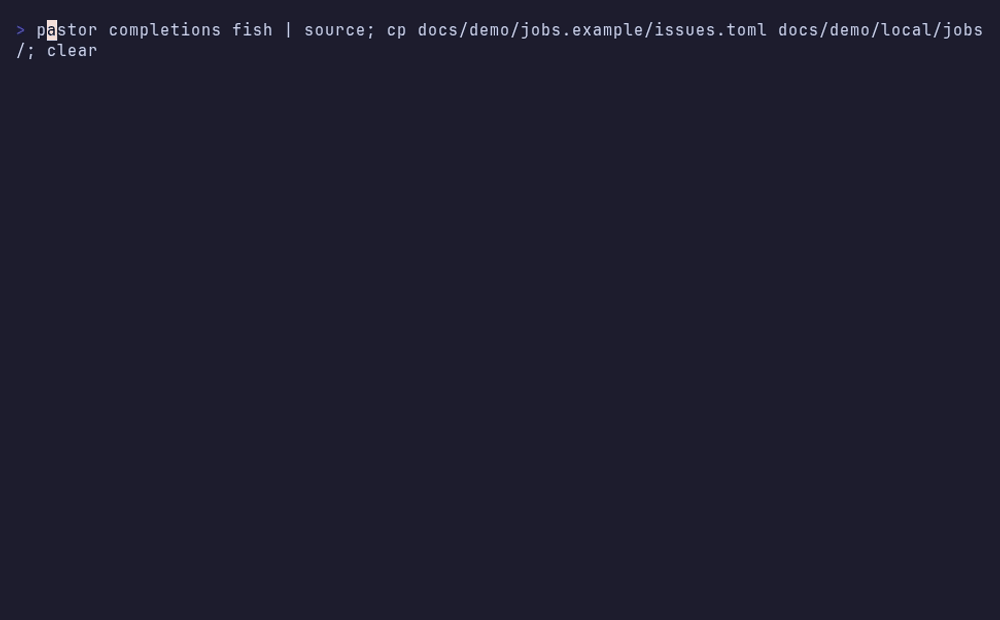

# pastor

**An agent orchestrator for a flock of machines.** Queue tasks, schedule
jobs, spread coding agents across your flock over ssh, and keep the machines
ready for them.

[](https://github.com/cacarico/pastor/actions/workflows/ci.yml)
[](https://github.com/cacarico/pastor/releases)
[](https://crates.io/crates/pastor-cli)
[](LICENSE)

pastor is the piece I was missing in my own AI workflow. I give it work: a
one-off task ("fix the flaky test"), or a job that finds work on a schedule,
such as new GitHub issues or cards on a board. pastor picks a free machine,
opens a terminal there, starts the agent (Claude Code, opencode, ...), sends
the prompt and keeps track of it. When I come back, I read what it did, answer
it if it asked something, or sit in its terminal and carry on.

pastor also looks after the machines the agents run on: it can set a machine
up, install the agent CLIs at the versions you pin, put your team's skills and
instructions in the agents' homes, and place the files an agent starts with in
its working folder, then check later that they are still as it left them.

There are bigger and more general projects in this space. pastor is not trying
to be one of them. It is a small tool I am building to improve how I use AI in
my daily work, personal projects and learning.

<p align="center">
  
</p>

## Who it's for

pastor is first for me: a developer who runs coding agents, has one or more
always-on machines (a home server, a Raspberry Pi, a spare laptop), and would
rather decide *what* to do than babysit *where* and *how* it runs.

It may also fit you if your workflow looks similar. pastor is the small layer
that does the babysitting: it queues the work, spreads it over your machines,
notices when an agent finished, got stuck or is waiting for you, and keeps a
history.

It is young, opinionated and shaped by my day-to-day use, not a product with
a stable contract. I try not to break existing setups, but compatibility is
best effort, and things may change a lot while pastor finds its shape.

It uses [herdr](https://herdr.dev) for the terminals, so every agent runs in a
real terminal you can attach to, on a machine you control. Nothing runs in
someone else's cloud. The longer story is in [the blog post](https://cacari.co/posts/pastor/).

## How it works

```text
   you ──► pastor CLI ──►  head: pastor serve  ──ssh + herdr──►  machine ──► agent in a
             ▲             queue · schedule ·                    (a Pi,       terminal, in a
             │             history · events                       a server)   git worktree
   jobs ─────┘                    │
   (a schedule + a connector:     └──► event hooks: comment on the issue,
    clock, GitHub issues, ...)          move the card, notify you
```

- **The head** is the machine whose `pastor serve` holds the queue, the
  schedule and the history.
- **Machines** take the tasks. The head can be one of them. Others are
  reached over ssh, and each runs herdr. A machine the head cannot reach (a
  laptop behind NAT) is a **pull machine**: it runs its own `pastor serve`,
  joins with a one-time token and asks the head for work.
- **A task** is one agent, one prompt, in a repo or, with `--worktree`, in a
  fresh git worktree of it, so two agents never edit the same checkout.
- **A job** is a schedule plus a **connector** that finds work, and a prompt
  template that turns each piece of work into a task.
- **A flock** is a named group of machines, for example `work` and
  `personal`, so work and personal agents never mix accounts.
- **A bundle** is a directory of what your team wants in its agents' homes on
  every machine of a flock: skills, hooks, instructions, settings, MCP
  servers. A **workdir set** is the same kind of thing for one working
  folder, placed before an agent starts there.

## Install

One line, no Rust toolchain and no sudo:

```sh
curl -fsSL https://cacari.co/pastor/install.sh | sh
```

It downloads the release for your OS and CPU, checks it against the
release's checksums, and puts a single `pastor` binary in `~/.local/bin`.
Or with cargo (the crate is called `pastor-cli`; the command is `pastor`):

```sh
cargo binstall pastor-cli          # the prebuilt release
cargo install pastor-cli --locked  # build from source: Rust 1.88+ and a C compiler
```

You also need:

- [herdr](https://herdr.dev) 0.9 or newer on every machine, with its server running
  (`pastor machine add NAME user@host --bootstrap` fetches and starts it on
  a new machine);
- ssh from the head to the other machines, without a passphrase prompt;
- git on the head, for `pastor connector install`;
- the agents themselves (`claude`, `opencode`, ...) on each machine. Install them as
  usual, or pin the versions of `claude` and `agy` in `flock.toml` and let
  `pastor machine install` bring each machine to them.

Each connector says what else it needs: `github-issues`, for example, uses an
authenticated `gh`, `jq` and `sh` on the head.

For a flock you'll run for a while, [docs/recommended-setup.md](docs/recommended-setup.md)
says how to put it together: flocks per account, least-privilege credentials
for agent machines, permissions, and the settings that keep agents moving.

## Quick start

Add the machines. The head can take tasks too:

```sh
pastor machine add here --local        # this machine
pastor machine add pi-1 user@pi-1      # a machine you can ssh to
pastor serve                           # start the head in the background
```

For a machine you reach over ssh, `pastor machine add pi-1 user@pi-1
--bootstrap` also sets it up from the head (with the head running and `head_address` set in pastor.toml): it pins the host key, copies pastor
and herdr over and runs `pastor bootstrap` there, as the machine's own user,
with no root and no `sudo` (see [Keeping machines ready](#keeping-machines-ready)).

`pastor serve status` shows it and `pastor serve stop` stops it; its log is
`~/.local/state/pastor/serve.log`. To keep it up after a reboot, run it as a
user service instead: `pastor setup systemd` (`setup launchd` on macOS).

Give it something to do, then check on it:

```sh
pastor task run "Fix the flaky test in ci.yml" --repo '~/work/api' --worktree
pastor task list                       # live tasks: queued, running, blocked ...
pastor task read t-1                   # the agent's recent output
pastor task attach t-1                 # sit in its terminal; ctrl+b q detaches
pastor task send t-1 "yes, go ahead"   # answer it without attaching
```

If the agent stops to ask you something, the task shows as `blocked` with
its question, instead of pretending it finished.

## Jobs: work that finds itself

A job is one TOML file in `~/.config/pastor/jobs/`. This one wakes an agent
every weekday morning:

```toml
# ~/.config/pastor/jobs/morning.toml
cron = "0 9 * * 1-5"

[connector]
use = "clock"

[dispatch]
repo = "~/work/api"
prompt = "It is {{ item.key }}. Run the test suite and fix what broke."
```

<p align="center">
  
</p>

`pastor job list` shows every job and when it runs next. `pastor job describe
morning` shows one in full, `pastor job run morning` fires it now, and
`pastor job edit morning` opens it in your `$EDITOR` and only saves it once
it's valid.

## Connectors: where the work comes from

A connector is a small program that turns an outside source into work items.
`clock` is built in. Others install from GitHub:

```sh
pastor connector install cacarico/pastor-connectors/github-issues
pastor connector list
pastor connector describe github-issues   # who wrote it, where it came from, what it needs, which jobs use it
```

<p align="center">
  
</p>

This job starts an agent for every open issue labelled `pastor`, each in its
own worktree and branch, and comments on the issue when the agent is done:

```toml
# ~/.config/pastor/jobs/issues.toml
every = "10m"

[connector]
use = "github-issues"
repo = "acme/widgets"
label = "pastor"

[dispatch]
repo = "~/work/widgets"
backfill = "30d"   # on the first run, also take issues from the last 30 days
worktree = true
branch = "pastor/issue-{{ item.key }}"
prompt = """
Fix issue #{{ item.key }}: {{ item.title }}

{{ item.body }}

Work test first, commit, and push the branch.
"""
```

Each piece of work has a stable key, so pastor never starts the same issue
twice. Without `backfill`, the first run only sees issues updated from then on.

Connectors in [pastor-connectors](https://github.com/cacarico/pastor-connectors):

| Connector | Turns into tasks |
|---|---|
| `clock` (built in) | a schedule: every N minutes, or a cron line |
| [`github-issues`](https://github.com/cacarico/pastor-connectors/tree/main/github-issues) | open issues with a label; comments on the issue when its task ends |
| [`github-pr-reviews`](https://github.com/cacarico/pastor-connectors/tree/main/github-pr-reviews) | Copilot reviews with open findings, so an agent can fix them on the PR's branch |

A connector can also ship **event hooks** that run when a task is queued,
starts, finishes, fails or blocks: comment somewhere, move a card, send a
notification. Writing one takes a manifest and a script in any language. See
[Connectors in the manual](docs/manual.md#connectors).

## Everyday commands

| To... | Run |
|---|---|
| see the fleet at a glance | `pastor status` |
| see your machines | `pastor machine list`, `pastor machine describe pi-1` |
| start one task | `pastor task run "..." --repo DIR [--worktree] [--machine M]` |
| follow tasks | `pastor task list`, `pastor task describe t-3`, `pastor events --follow` |
| talk to an agent | `pastor task read t-3`, `pastor task send t-3 "..."`, `pastor task attach t-3` |
| end a task | `pastor task close t-3` (an agent can run `pastor task done` itself) |
| manage jobs | `pastor job list`, `pastor job describe NAME`, `pastor job run NAME`, `pastor job edit NAME` |
| run orchestrators | `pastor orchestrator list`, `pastor orchestrator describe NAME`, `pastor orchestrator run NAME`, `pastor orchestrator start NAME`, `pastor orchestrator stop NAME` (files in `~/.config/pastor/orchestrators/`, see [the manual](docs/manual.md#orchestrators)) |
| manage flocks | `pastor flock list`, `pastor flock describe NAME`, `pastor flock edit` |
| change settings | `pastor config edit` |
| see why a task waits | `pastor queue` |
| set a machine up, check it, bring it to its pins | `pastor machine add NAME user@host --bootstrap`, `pastor machine check NAME`, `pastor machine install NAME` |
| sign an agent in | `pastor login MACHINE AGENT`, `pastor agent signed-in --machine MACHINE AGENT` |
| keep agents' homes in line | `pastor bundle add DIR`, `pastor bundle apply MACHINE` |
| place files in a working folder | `pastor workdir place MACHINE DIR --set FILE`, `pastor workdir check MACHINE DIR` |
| see a permission profile | `pastor profile list`, `pastor profile render --kind claude NAME` |
| use connectors | `pastor connector list`, `pastor connector describe ID`, `pastor connector install OWNER/REPO/DIR` |

Every list and describe takes `--json`. `make install` also installs fish
and bash completions that complete real names: `pastor job describe <TAB>`
lists your jobs, and `pastor task read <TAB>` lists your live tasks.

## Work and personal, on the right accounts

Put machines in flocks, and give a flock or a single machine its own agent:

```toml
# ~/.config/pastor/flock.toml
[[flock]]
name = "personal"
default = true
machines = { laptop = 2 }   # laptop runs at most 2 personal tasks

[[flock]]
name = "work"
machines = { pi-1 = 2 }

[[machine]]
name = "laptop"
local = true
agent = "claude-alt"   # this machine's plain `claude` is a work login

[[machine]]
name = "pi-1"
ssh = "pi-1"
```

```toml
# ~/.config/pastor/pastor.toml
[agents.claude-alt]
kind = "claude"
env = { CLAUDE_CONFIG_DIR = "~/.claude-alt" }
```

A task only ever runs on a machine in its own flock, with the agent that
machine names.

## Keeping machines ready

pastor makes a machine ready for the agents that land on it and tells you when
it drifts. It never installs an OS package or calls `sudo`: what only the
machine's owner can do, it reports, and stops.

- **Set up.** `pastor machine add NAME user@host --bootstrap` (or `pastor
  machine bootstrap NAME`) sets an ssh machine up from the head; `pastor join`
  does it from the new machine, with a token from `pastor join create`, and
  makes it a pull machine. Both end in a report the head keeps.
- **Checked.** `pastor machine check NAME` runs the machine's provisioner's
  checks and says what it lacks for the agents that can land on it; it changes
  nothing. Built-in provisioners cover arch, debian, macos and raspberry-pi-os.
- **Harness versions.** A flock names the version of each harness it expects,
  and `pastor machine list` shows where a machine differs:

  ```toml
  # fragment of flock.toml
  [[flock]]
  name = "work"
  machines = { pi-1 = 2 }
  pins = { claude = "2.1.310", agy = "1.4" }
  ```

  `pastor machine install pi-1` brings it to the pins. Nothing installs on
  its own.
- **Logins, trust and limits.** `pastor login pi-1 claude` opens an agent's
  login in a pane there and shows the URL and code; `pastor agent signed-in`
  checks one (`--machine pi-1 claude`); `pastor trust add pi-1 /home/pi/work/api` saves a repo for folder-trust
  prompts to be answered; `pastor limit list` shows the accounts that ran out
  of usage, which no new task starts on until they reset.
- **Agent homes.** A bundle is kept on the head with `pastor bundle add DIR`
  and named in `flock.toml` (`bundles = ["team-rules"]`); `pastor bundle apply
  pi-1` places its skills, hooks and instructions in the homes of that
  machine's agents and merges its settings, and takes out what it no longer
  gets. `pastor bundle adopt` takes over a home that already has files. With
  `bundle_apply = "auto"` the head keeps the homes of its ssh and local
  machines in line by itself.
- **Permission profiles.** A profile is a named allow and deny list.
  `pastor profile render --kind claude NAME` shows what it becomes for a
  harness (`claude` or `agy`): its flags, env and settings, and what that
  harness cannot carry.
- **Updating pastor.** `pastor fleet update VERSION` puts a version from the
  head's artifact cache on every machine it reaches, the head last.

[The manual](docs/manual.md#bootstrapping-a-machine) has each part in full.

## Files for an agent's working folder

A workdir set is what one agent starts with in its folder: skills, hook
scripts, agent files, settings and instructions, in a JSON or TOML document
that names its harness (`claude` or `agy`). pastor places it, writes a ledger
of what it put there, keeps those files out of git, and later takes out what a
newer, smaller set no longer has, or everything it placed.

```sh
pastor workdir place pi-1 /home/pi/work/api --set agent-set.json    # through the head
pastor workdir place --local ~/work/api --set agent-set.json # on the machine itself
pastor workdir check pi-1 /home/pi/work/api    # still as placed? ok, drift, conflict, ...
pastor workdir remove pi-1 /home/pi/work/api
pastor workdir list                     # every directory the head placed sets in
```

Three ways in:

- **By hand, or by whatever starts the agent.** Anything that launches an
  agent can hand pastor the set before the start. On a pull machine it runs
  `pastor workdir place --local` there, and the machine reports what it did
  to the head.
- **With a task.** `pastor task run --workdir-set agent-set.json ...`, or
  `workdir_set` in a job's `[dispatch]`, places the set in the task's folder
  before every start.
- **From a bundle.** A bundle whose manifest says `target = "workdir"` is a set
  kept on the head by version. Name it in `workdir_bundles` on a flock or a
  job, and the head places it before each start of the task.

[The manual](docs/manual.md#workdir-bundles) has the set format, what `check`
says and the rules for a task.

## Safety

- **Agents can't take over your flocks.** Every agent pastor starts is
  marked. It can read tasks and end its own with `pastor task done`, but
  can't start tasks, stop other tasks, edit machines, jobs or settings, or
  start its own head.
- **Orchestrators get a little more.** An orchestrator task (`task run
  --role orchestrator`, or one an orchestrator file starts) and its scripts
  may also run, retry, send to and close tasks, enable or disable a job and
  keep a handover note. No task can start one.
- **Claude's startup dialogs are answered for you.** Folder trust once a
  repo is saved, and the one-time offers Claude shows on a new machine; the
  bypass warning and permission prompts stay yours (`pastor task send
  --pick`).
- **Permission prompts stay on unless you pick a profile.** pastor passes
  the allow and deny lists you set. A profile (`review`, `develop`,
  `unrestricted`) turns Claude's prompts off and refuses what its lists
  don't allow; [the manual](docs/manual.md#trust-model) says when not to.
- **Nothing is closed that pastor didn't open.** pastor closes only the panes
  and workspaces it created, and keeps a worktree with unpushed commits or
  another agent in it.
- **Releases are signed.** Each release has checksums and a GitHub build
  attestation (`gh attestation verify ...`). Report vulnerabilities privately:
  see [SECURITY.md](SECURITY.md).

## Platforms

| Platform | Support |
|---|---|
| Linux x86_64 | built, tested in CI and released |
| Linux aarch64 | built, smoke-run and released |
| Linux armv7, riscv64 | built and released |
| macOS arm64, x86_64 | built and released; `pastor setup launchd` for the service |
| FreeBSD x86_64 | compiled on every pull request, no binaries |
| Windows | not supported; use WSL2 |

Linux binaries are static, so one download per CPU runs on any distro and on
every Raspberry Pi OS release.

## Learn more

- [The manual](docs/manual.md): every command, task state, file and setting.
- [Skill for agents](skills/pastor/SKILL.md): what a coding agent needs to know
  to use pastor, or to behave when pastor started it. `pastor --skill` prints it.
- [Spec skill](skills/spec/SKILL.md): `/pastor:spec` turns an idea into a plan
  your machines can run, one task after another, with nobody watching.
- [Connector skill](skills/connector/SKILL.md): `/pastor:connector`
  scaffolds a poll or stream connector and tests it before you install it.
- [Dispatch skill](skills/dispatch/SKILL.md): `/pastor:dispatch` runs a
  `pastor:spec` plan's next task and handles `blocked`, `done`, `failed`
  and `stale` by fixed rules, with nobody else watching the branch.
- [Review skill](skills/review/SKILL.md): `/pastor:review` checks a
  finished plan branch, sends back one fix task for what it finds, and
  opens the pull request.
- [Changelog](CHANGELOG.md).

## Contributing

Issues and pull requests are welcome, especially when they fit the direction
above. pastor is still my personal workflow tool first, so I may decline good
ideas that would pull it away from that shape.

`make check` runs the changelog check, formatting, clippy and the whole test
suite against a fake herdr, so you don't need a flock of machines to work on
pastor; `make help` lists the rest.
Start with [CONTRIBUTING.md](CONTRIBUTING.md) and [AGENTS.md](AGENTS.md). How
AI is used here is in [docs/AI_GOVERNANCE.md](docs/AI_GOVERNANCE.md).

## License

[Apache License 2.0](LICENSE).
